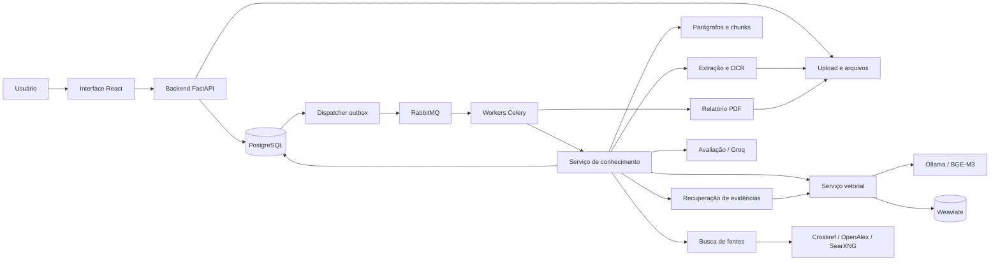

# CitaLens

**Revisão de citações bibliográficas em PDFs, com fontes rastreáveis e apoio à revisão humana.**

[](LICENSE)
[](requirements.lock)
[](frontend/package.json)
[](docker-compose.yml)

O CitaLens, também identificado na interface como *Autobibliograph Revision*, ajuda pesquisadores, estudantes e revisores a examinar se as fontes citadas sustentam as afirmações de um manuscrito. A aplicação cataloga a bibliografia, localiza as citações no texto, busca as obras e compara cada afirmação com passagens efetivamente obtidas da fonte.

Cada resultado mantém a referência, a localização no PDF, as evidências, o escopo consultado e as limitações da análise. A revisão pode ser acompanhada pela interface web e exportada em um relatório de **até 20 páginas**.

[Instalação](#instalação) · [Configuração](#configuração) · [Como usar](#como-usar) · [Documentação técnica](#documentação-técnica) · [Exemplo de relatório](tests/fixtures/example-report.pdf)

## Sumário

- [Funcionalidades](#funcionalidades)
- [Como a análise funciona](#como-a-análise-funciona)
- [Tecnologias e arquitetura](#tecnologias-e-arquitetura)
- [Instalação](#instalação)
- [Configuração](#configuração)
- [Como usar](#como-usar)
- [Como interpretar os resultados](#como-interpretar-os-resultados)
- [Relatórios e histórico](#relatórios-e-histórico)
- [API](#api)
- [Desenvolvimento e testes](#desenvolvimento-e-testes)
- [Operação e solução de problemas](#operação-e-solução-de-problemas)
- [Privacidade e armazenamento](#privacidade-e-armazenamento)
- [Limitações](#limitações)
- [Estrutura do repositório](#estrutura-do-repositório)
- [Documentação técnica](#documentação-técnica)
- [Contribuição](#contribuição)
- [Licença](#licença)

## Funcionalidades

| Recurso | Comportamento |
|---|---|
| Biblioteca de documentos | Cadastro, autenticação, upload de PDFs e histórico de análises por usuário. |
| Extração de texto | Leitura nativa do PDF e OCR seletivo com Tesseract em português e inglês. |
| Catálogo bibliográfico | Extração de referências, autores, títulos, anos e identificadores, com tratamento de bibliografias em duas colunas. |
| Mapeamento de citações | Identificação de ocorrências e associação às referências, preservando candidatos e ambiguidades. |
| Trechos por parágrafo | Cada trecho corresponde a um parágrafo inteiro de prosa, sem janelas fixas nem sobreposição. |
| Filtro de conteúdo | Tabelas, imagens, diagramas, legendas, títulos e rodapés detectados são excluídos dos trechos semânticos. |
| Busca de fontes | Crossref, OpenAlex e SearXNG consultam metadados e descobrem conteúdo acessível. |
| Recuperação de evidências | Embeddings BGE-M3 locais e busca híbrida no Weaviate, limitada à obra e versão corretas. |
| Avaliação semântica | Qwen 3.8 27B via Groq, com saída estruturada e validação das passagens citadas. |
| Revisão humana | Correção de vínculos, comentários, revisão de pareceres e anexação de fontes complementares. |
| Relatório PDF | Resumo com cobertura, evidências e resultados agrupados, limitado a 20 páginas. |
| Execução assíncrona | Acompanhamento de etapas, cancelamento cooperativo e registro de falhas e limitações. |

O filtro de prosa e o parser bibliográfico usam regras e geometria do documento. Layouts ambíguos podem exigir correção humana; a exclusão automática de todos os elementos não narrativos não é garantida.

## Como a análise funciona

1. **Receber o PDF:** validar o arquivo e registrar sua versão.
2. **Extrair as páginas:** obter texto nativo e aplicar OCR onde necessário, preservando a localização original.
3. **Catalogar a bibliografia:** identificar as referências antes de mapear as citações do corpo do documento.
4. **Mapear as ocorrências:** associar cada marcador ao parágrafo e às referências candidatas.
5. **Consultar as fontes:** corroborar a identidade bibliográfica e tentar obter conteúdo acessível.
6. **Recuperar e avaliar:** selecionar parágrafos relevantes dentro do orçamento e comparar a afirmação com a evidência.
7. **Registrar e apresentar:** persistir o parecer, suas limitações e o histórico, gerando o relatório.

Metadados, snippets de busca e similaridade vetorial ajudam a encontrar fontes. A sustentação de uma afirmação depende do conteúdo obtido da obra. O manuscrito não é usado como evidência de si mesmo.

## Tecnologias e arquitetura

| Camada | Tecnologias |
|---|---|
| Interface | React 19, JavaScript, Vite e nginx |
| APIs | Python 3.12, FastAPI e Pydantic |
| Persistência | PostgreSQL, SQLAlchemy e Alembic |
| Filas e tarefas | RabbitMQ e Celery, com outbox persistente |
| Extração | PyMuPDF e Tesseract OCR |
| Embeddings | Ollama com `bge-m3:567m`, vetores de 1.024 dimensões |
| Busca vetorial | Weaviate, combinando vetores e busca lexical |
| Fontes acadêmicas | Crossref e OpenAlex |
| Busca web | SearXNG local; adaptador Brave opcional |
| Modelo de linguagem | Groq com `qwen/qwen3.8-27b`; adaptadores OpenAI e Ollama opcionais |
| Relatórios | ReportLab |
| Testes | pytest e Playwright |
| Execução | Docker Compose |



A aplicação possui dez APIs: backend, upload, OCR, chunks, vetor, conhecimento, RAG, LLM, busca e relatório. Workers e dispatcher executam o trabalho assíncrono. PostgreSQL mantém os registros e a proveniência; Weaviate fornece um índice reconstruível. Os detalhes estão em [Arquitetura](docs/architecture.md).

## Instalação

### Pré-requisitos

- Git para clonar o repositório.
- Docker Engine com contêineres Linux e Docker Compose v2 ou compatível.
- Acesso à internet para baixar imagens, dependências e o modelo de embeddings; a análise real também consulta provedores externos.
- Memória e disco para o conjunto de serviços. Cerca de **14 GB de memória disponíveis para o ambiente** é uma estimativa de planejamento, não um mínimo medido; o consumo varia com os PDFs e a concorrência.

O Compose executa os embeddings em CPU, sem GPU obrigatória. Na primeira inicialização, `ollama-pull` baixa aproximadamente 1,2 GB de pesos BGE-M3. Python, Node, Tesseract e Ollama não precisam ser instalados separadamente no host para executar a aplicação. No Linux/macOS, o script opcional de geração do `.env` usa Python 3.

### 1. Clonar o repositório

```sh
git clone https://github.com/vmendeso/CitaLens.git
cd CitaLens
```

### 2. Gerar a configuração local

**Windows / PowerShell:**

```powershell
powershell -ExecutionPolicy Bypass -File scripts/setup-env.ps1
```

**Linux / macOS:**

```sh
python3 scripts/setup_env.py
```

Os scripts criam `.env` a partir de [.env.example](.env.example), geram segredos locais aleatórios e preservam um arquivo existente. Se `.env` já existir, revise suas variáveis em vez de executar novamente a criação. Para configuração manual, copie o exemplo e substitua todos os valores `CHANGE_ME` por segredos aleatórios distintos.

Para análise real, preencha as chaves descritas em [Configuração](#configuração). Para experimentar a demonstração, elas podem permanecer vazias. Nenhuma conta de usuário vem cadastrada.

### 3. Iniciar os serviços

```sh
docker compose config --quiet
docker compose up --build -d
docker compose ps
```

O primeiro início pode demorar devido ao download dos modelos e à construção das imagens. `migrate` e `ollama-pull` são tarefas de inicialização: terminar com código `0` é o comportamento esperado. Consulte todas as tarefas com:

```sh
docker compose ps -a
docker compose logs --tail=100 migrate ollama-pull
```

### 4. Acessar

| Recurso | Endereço |
|---|---|
| Aplicação | [http://localhost:8080](http://localhost:8080) |
| Documentação interativa da API | [http://localhost:8000/docs](http://localhost:8000/docs) |
| Liveness | [http://localhost:8000/health/live](http://localhost:8000/health/live) |
| Readiness | [http://localhost:8000/health/ready](http://localhost:8000/health/ready) |

Somente frontend e backend publicam portas, vinculadas a `127.0.0.1`. Os demais serviços ficam nas redes do Compose. Um serviço saudável pode operar sem chave de provedor; a disponibilidade da chave e do modelo é verificada durante a operação correspondente.

## Configuração

Todas as variáveis disponíveis estão em [.env.example](.env.example). Edite o `.env` local e mantenha-o fora do Git.

### Configuração padrão para análise real

```dotenv
LLM_PROVIDER=groq
LLM_MODEL=qwen/qwen3.8-27b
LLM_BASE_URL=https://api.groq.com/openai/v1
GROQ_API_KEY=sua_chave_groq

OPENALEX_ENABLED=true
OPENALEX_API_KEY=sua_chave_openalex
CROSSREF_MAILTO=seu_contato@example.org

WEB_PROVIDER=searxng
SEARXNG_BASE_URL=http://searxng:8080

EMBEDDING_PROVIDER=ollama
EMBEDDING_MODEL=bge-m3:567m
EMBEDDING_DIMENSIONS=1024
EMBEDDING_VERSION=2
EMBEDDING_BASE_URL=http://ollama:11434
EMBEDDING_BATCH_SIZE=8
EMBEDDING_TIMEOUT=120
```

Esse bloco contém apenas as opções dos provedores; preserve os segredos de banco, fila e autenticação gerados pelo script. Depois de alterar a configuração:

```sh
docker compose up --build -d
```

### Chave Groq

Crie uma conta no [console Groq](https://console.groq.com), gere uma chave na área **API Keys** e salve-a em `GROQ_API_KEY`. O [guia oficial de início](https://console.groq.com/docs/quickstart) descreve a criação e o uso da credencial.

O padrão do projeto é **Qwen 3.8 27B**, com identificador `qwen/qwen3.8-27b`, hospedado na Groq. O adaptador usa [JSON Schema estrito](https://console.groq.com/docs/structured-outputs). O modelo consta como preview no [catálogo Groq](https://console.groq.com/docs/models), portanto confira sua disponibilidade antes de atualizar a configuração.

Sem a chave, a avaliação real registra a limitação e permanece inconclusiva. Um HTTP 403 pode indicar que a organização ou o projeto bloqueou o modelo; confira as [permissões de modelos](https://console.groq.com/docs/model-permissions). `OPENAI_API_KEY` não autentica chamadas à Groq.

### Chave OpenAlex

1. Crie uma conta em [OpenAlex](https://openalex.org).
2. Confirme seu e-mail.
3. Copie a chave em **Settings → API key**.
4. Salve-a em `OPENALEX_API_KEY` no `.env`.

Consultas básicas de metadados podem funcionar sem chave. O download de PDFs do acervo OpenAlex exige uma chave válida e consome a cota da conta. Consulte a [autenticação](https://help.openalex.org/api/authentication/) e o [acesso ao conteúdo](https://help.openalex.org/access/fulltext/).

O CitaLens busca obras por DOI ou título, confere os metadados e prioriza PDFs públicos de acesso aberto. Quando disponível, o PDF do acervo OpenAlex serve como alternativa autenticada. A integração processa PDF; não importa TEI XML nem contorna restrições de acesso.

### Crossref e SearXNG

Crossref contribui com a identificação bibliográfica; `CROSSREF_MAILTO` informa um contato opcional para suas consultas.

O SearXNG executa localmente e usa **Mwmbl, arXiv e PubMed** como mecanismos complementares. Não exige uma chave de API de busca externa. `SEARXNG_SECRET_KEY` é o segredo interno da instância, gerado pelo script de configuração; não é uma credencial de conta de busca.

Mesmo executado localmente, SearXNG envia consultas bibliográficas aos mecanismos externos e depende da disponibilidade deles. Detalhes de configuração estão no [guia de operação](docs/operations.md#busca-web-local-e-chave-do-searxng).

### Embeddings locais e provedores opcionais

Os embeddings usam BGE-M3 via Ollama, sem chave externa. Os pesos são armazenados no volume `ollama-data` e reutilizados nas próximas inicializações.

| Opção | Efeito |
|---|---|
| `EMBEDDING_PROVIDER=none` | Desativa embeddings; a recuperação lexical permanece disponível. |
| `LLM_PROVIDER=none` | Desativa a inferência do modelo para a análise real. |
| `WEB_PROVIDER=none` | Desativa a busca web geral; as integrações bibliográficas continuam independentes. |
| `OPENALEX_ENABLED=false` | Desativa as consultas OpenAlex. |
| `WEB_PROVIDER=brave` | Usa o adaptador Brave com `BRAVE_API_KEY`. |
| `LLM_PROVIDER=openai` ou `ollama` | Usa outro adaptador de chat, com URL, modelo e credenciais próprios. |

Ollama precisa de um modelo de chat instalado separadamente para avaliar afirmações: BGE-M3 produz embeddings. A configuração completa dos adaptadores está em [Provedores](docs/providers.md).

Trocar modelo, dimensão ou versão de embeddings exige [reindexar os documentos existentes](docs/operations.md#embeddings-e-reconstrução). Isso reconstrói a busca a partir dos chunks armazenados; não recalcula os pareceres.

### Limites padrão

| Configuração | Valor padrão |
|---|---|
| Manuscrito | 30 MiB e 500 páginas |
| PDF de fonte obtido automaticamente | 20 MiB e 400 páginas |
| PDF de fonte anexado pelo usuário | 20 MiB e 500 páginas; usa o limite de páginas do upload |
| Idiomas do OCR | `por+eng` |
| Consultas externas por análise | 100 |
| Orçamento de tokens LLM por análise | 200.000 |
| Prazo configurado da análise | 3.600 segundos |
| Relatório PDF | Até 20 páginas |

Os valores configuráveis estão em `.env.example`. A interface também limita uploads a 30 MiB para manuscritos e 20 MiB para fontes; aumentar somente o limite do backend não amplia o limite do navegador. Orçamentos e prazos não garantem que toda referência será consultada. Tokens de embeddings não entram no orçamento do LLM.

## Como usar

### Experimentar a demonstração

1. Abra a aplicação e crie uma conta.
2. Clique para enviar um documento e baixe o manuscrito de demonstração.
3. Selecione o PDF baixado e marque explicitamente **Demonstração**.
4. Inicie a análise e acompanhe suas etapas.
5. Examine as três afirmações de exemplo, suas evidências e o relatório.

A demonstração usa fontes e pareceres sintéticos previamente anotados. Ela permite conhecer a interface sem credenciais Groq/OpenAlex, mas não executa pesquisa acadêmica real nem inferência de LLM. Um PDF arbitrário nesse modo não recebe confirmações inventadas. O Compose ainda instala os componentes locais, incluindo o modelo de embeddings.

As [fixtures](tests/fixtures/) são sintéticas e disponibilizadas como CC0. O [relatório de exemplo](tests/fixtures/example-report.pdf) é uma demonstração, não uma avaliação de um documento real.

### Analisar um manuscrito

1. Configure os provedores e envie um PDF.
2. Selecione **Análise real**, o idioma e, se desejar, o estilo de citação.
3. Se a bibliografia não for detectada corretamente, informe suas páginas inicial e final. Use a numeração física do PDF, começando em `1`.
4. Acompanhe a extração, as referências, as ocorrências e a obtenção das fontes.
5. Na aba de achados, compare a afirmação com as passagens da obra e leia o escopo e as limitações.
6. Registre sua revisão, corrija vínculos ou anexe uma fonte complementar quando necessário.
7. Baixe o relatório. Após corrigir vínculos ou anexar fontes, inicie uma **nova análise** para aplicar essas informações.

Selecionar ABNT, APA ou Vancouver registra o estilo pretendido; não implica validação integral da norma. A confirmação de identidade de uma fonte anexada é registrada como declaração humana.

## Como interpretar os resultados

Cada parecer separa quatro perguntas:

| Dimensão | Pergunta |
|---|---|
| Vínculo | O marcador da citação foi associado à referência correta? |
| Identidade | Os metadados permitem confirmar a obra citada? |
| Acesso | Qual conteúdo da obra foi efetivamente obtido? |
| Apoio semântico | Esse conteúdo sustenta a afirmação do manuscrito? |

O resultado semântico pode ser:

| Estado | Significado |
|---|---|
| `SUPPORTED` | Há evidência explícita compatível com a afirmação. |
| `PARTIALLY_SUPPORTED` | Parte da afirmação tem apoio; outra parte extrapola ou exige ajuste. |
| `CONTRADICTED` | Uma passagem da fonte conflita explicitamente com a afirmação. |
| `NOT_SUPPORTED_BY_REVIEWED_CONTENT` | A afirmação não foi sustentada pelo conteúdo consultado, com as exigências de cobertura atendidas. |
| `INCONCLUSIVE` | Identidade, acesso, evidência, cobertura ou execução não permitem decidir. |
| `NOT_EVALUATED` | Não há avaliação semântica disponível para o item. |

**Uma fonte inacessível ou um parecer inconclusivo não demonstra que a afirmação está errada.** Uma passagem de acesso parcial pode apoiar uma afirmação delimitada; concluir ausência de apoio exige cobertura suficiente. A interface informa páginas e parágrafos consultados.

`COMPLETED_WITH_WARNINGS` indica que a análise terminou registrando limitações. É diferente de uma falha de execução (`FAILED`) e pode incluir pareceres sustentados por evidências.

## Relatórios e histórico

O relatório agrupa resultados e limitações repetidos e prioriza achados que exigem atenção. O limite de **20 páginas** considera a paginação real, incluindo resumo, cobertura e detalhes. Quando o conteúdo não cabe, o PDF informa a seleção; os resultados completos continuam disponíveis na interface.

| Operação | O que muda |
|---|---|
| Baixar um relatório existente | Recupera a versão histórica já gerada. |
| Gerar nova versão do relatório | Reapresenta o snapshot da análise; não busca fontes nem reavalia afirmações. |
| Reindexar o documento | Reconstrói o índice de busca dos chunks armazenados. |
| Iniciar nova análise | Executa novamente o processamento e aplica as fontes/correções humanas pertinentes, preservando o histórico. |

## API

A documentação interativa fica em [Swagger UI](http://localhost:8000/docs). A API pública usa o prefixo `/api/v1` e autenticação Bearer JWT nas rotas protegidas.

| Método | Rota | Finalidade |
|---|---|---|
| `POST` | `/auth/register` | Criar conta. |
| `POST` | `/auth/login` | Obter token de acesso. |
| `POST` | `/documents` | Enviar PDF com multipart `file`. |
| `POST` | `/documents/{id}/analyses` | Iniciar análise assíncrona. |
| `GET` | `/analyses/{id}/progress` | Consultar etapas e contagens. |
| `GET` | `/analyses/{id}/findings` | Listar pareceres. |
| `GET` | `/findings/{id}/evidence` | Consultar as evidências do parecer. |
| `GET` | `/reports/{id}/download` | Baixar um relatório autorizado. |

Os caminhos da tabela são relativos ao prefixo. A criação de análise retorna HTTP `202` com identificador e rota de acompanhamento. Revisões, cancelamento, fontes complementares e demais endpoints estão em [Contratos HTTP e eventos](docs/contracts.md). As APIs internas usam `X-Internal-Token` e não são publicadas diretamente no host.

## Desenvolvimento e testes

### Python

Com Python 3.12 e um ambiente virtual ativo, execute na raiz:

```sh
python -m pip install -r requirements.lock
python -m pytest -q
```

Os testes que exigem OCR real ou infraestrutura são ignorados explicitamente quando o requisito falta. Para regenerar as fixtures sintéticas, use `python scripts/generate_fixtures.py`; isso não é necessário para uma instalação comum.

### Integração com Docker

Com o Compose local em execução:

```sh
docker compose --profile test run --rm integration-tests
```

O perfil exercita PostgreSQL, constraints e privilégios, Weaviate, filas e fluxo HTTP. O teste de migrations cria e remove apenas um banco temporário de nome exclusivo. Use esse perfil no ambiente local de desenvolvimento. Veja os detalhes em [Validação](docs/validation.md).

### Frontend

Com Node.js 22.16.0 ou compatível com o projeto, e a API em execução:

```sh
cd frontend
npm ci
npm run dev
```

Vite serve a interface em `http://localhost:5173` e encaminha a API para `localhost:8000`. `API_PROXY_TARGET` permite trocar esse destino. Para build e testes:

```sh
npm run build
npx playwright install chromium
npm run test:e2e
```

Os testes padrão da interface usam respostas HTTP simuladas. Para testar o fluxo de demonstração contra o **Compose real**, ainda em `frontend/`:

```sh
# Linux/macOS
CITALENS_E2E_LIVE=1 CITALENS_BASE_URL=http://localhost:8080 npm run test:e2e -- e2e/live.spec.js
```

```powershell
# PowerShell
$env:CITALENS_E2E_LIVE = "1"
$env:CITALENS_BASE_URL = "http://localhost:8080"
npm run test:e2e -- e2e/live.spec.js
```

Esse cenário cria uma conta de teste, envia a fixture de demonstração e verifica o relatório, sem mocks HTTP. Ele não testa a qualidade de um LLM nem exige chamadas reais à Groq. Consulte [frontend/README.md](frontend/README.md) para usar um Chrome já instalado e localizar os artefatos dos testes.

### Validação registrada

Na auditoria de **20/10/2026**, foram registrados **303 testes Python aprovados, 7 ignorados e 10 testes de navegador aprovados**. Uma execução adicional com um manuscrito sintético citando um artigo público validou a busca da fonte, a chamada real ao Qwen, a evidência exibida e o download de um relatório de duas páginas.

Esses são resultados de uma execução documentada, não uma medição de acurácia geral nem um indicador de CI contínua. Consulte os cenários, versões e limitações em [docs/validation.md](docs/validation.md).

## Operação e solução de problemas

Execute os comandos abaixo na raiz do repositório.

```sh
# Estado dos serviços
docker compose ps -a

# Logs das principais etapas
docker compose logs --tail=100 backend-api knowledge-service web-search-service llm-service

# Modelos disponíveis no Ollama
docker compose exec ollama ollama list

# Parar sem remover os contêineres
docker compose stop

# Iniciar novamente
docker compose up -d
```

`docker compose down` remove os contêineres e preserva os volumes nomeados. Adicionar `-v` apaga os volumes e seus dados. PostgreSQL e o volume `file-data` devem ser incluídos em backups coordenados; veja [Operação, dados e recuperação](docs/operations.md).

| Sintoma | Verificação |
|---|---|
| Docker não inicia a aplicação | Confirme que o Engine está ativo, em modo Linux, e que `.env` foi criado. |
| Serviço vetorial demora no primeiro início | Confira `docker compose logs --tail=100 ollama-pull vector-service`; o modelo pode estar sendo baixado. |
| Groq retorna 401 ou ausência de chave | Confira `GROQ_API_KEY` e recrie os serviços após editar `.env`. |
| Groq retorna 403 por modelo bloqueado | Confira a permissão da organização/projeto para o modelo configurado. |
| OpenAlex retorna 401/403 | Confira a chave, a confirmação do e-mail e a recriação de `web-search-service`. |
| Provedor retorna 429 | Verifique limites e cota da conta; a falha não comprova inexistência da obra. |
| Fonte sem conteúdo acessível | Examine as limitações ou anexe um PDF autorizado e inicie nova análise. |
| Referências segmentadas incorretamente | Informe o intervalo físico da bibliografia e revise o catálogo; layouts complexos podem exigir intervenção. |
| Embedding falha por memória ou prazo | Confira Ollama, tamanho dos parágrafos, `EMBEDDING_BATCH_SIZE` e `EMBEDDING_TIMEOUT`. |
| Relatório antigo continua longo | Gere uma nova versão do relatório. |
| Resultados antigos não mudaram | Inicie nova análise; gerar PDF ou reindexar não recalcula pareceres. |

## Privacidade e armazenamento

No Compose padrão, PDFs, textos extraídos, registros bibliográficos, evidências e relatórios ficam no ambiente local. Os embeddings são calculados no Ollama local.

A análise real usa serviços externos conforme a configuração:

| Destino | Dados enviados |
|---|---|
| Crossref, OpenAlex e mecanismos de busca | Identificadores e metadados bibliográficos necessários à consulta. |
| Editoras e repositórios | Requisições às URLs das fontes para obter conteúdo acessível. |
| Groq ou outro LLM externo | Afirmação, contexto da ocorrência, metadados e passagens selecionadas da fonte. |
| Provedor externo de embeddings, se configurado | Textos dos chunks e consultas de recuperação. |

As chaves ficam no servidor e não são incluídas no bundle do frontend. O `.env` está no `.gitignore`. A API autoriza o acesso por usuário e documento; a exclusão remove os registros, vetores e arquivos associados, enquanto backups seguem a política do operador.

O ambiente fornecido se destina à execução local. Publicação na internet exige configuração operacional adicional, como TLS, gestão de acesso e backups. As medidas implementadas e os limites do isolamento estão descritos em [Operação](docs/operations.md) e [Provedores](docs/providers.md).

## Limitações

- O CitaLens auxilia a revisão humana. Não certifica veracidade científica, ausência de plágio ou conformidade completa com ABNT, APA ou Vancouver.
- Extração, OCR e identificação bibliográfica podem falhar em páginas degradadas, fórmulas, múltiplas colunas ou marcadores incomuns.
- Uma obra identificada pode permanecer inacessível. O sistema não ultrapassa paywalls nem presume leitura integral a partir de um resumo.
- Parágrafos são preservados inteiros. Se um parágrafo não couber nos limites de entrada, a limitação fica registrada; não há corte silencioso do trecho.
- O orçamento pode limitar a quantidade de fontes e de parágrafos avaliados. O escopo efetivamente enviado ao modelo permanece explícito.
- Validação de schema, identidade e citações literais reduz falhas de proveniência, mas não elimina erros de interpretação do modelo.
- Resultados de fixtures e de um artigo de teste não demonstram desempenho em todos os domínios acadêmicos.

Veja [Limitações de extração e mapeamento](docs/parser-limitations.md).

## Estrutura do repositório

```text
CitaLens/
├── frontend/                     Interface React, nginx e testes Playwright
├── services/                     APIs, workers, dispatcher e configuração SearXNG
├── packages/
│   ├── common/                   Configuração, banco, modelos e autenticação
│   ├── contracts/                Schemas HTTP e contratos de avaliação
│   ├── document_processing/      Extração, bibliografia, citações e relatórios
│   └── providers/                Busca, downloads, embeddings, recuperação e LLM
├── migrations/                   Migrações Alembic e permissões do banco
├── scripts/                      Configuração, reindexação e fixtures
├── tests/                        Testes Python e fixtures sintéticas
├── docs/                         Documentação técnica e validação
├── .env.example                  Variáveis de configuração sem credenciais reais
├── docker-compose.yml            Serviços, redes e volumes locais
├── requirements.lock             Dependências Python fixadas
└── LICENSE                       Licença MIT
```

## Documentação técnica

| Documento | Conteúdo |
|---|---|
| [Arquitetura](docs/architecture.md) | Componentes, diagramas, processamento assíncrono e decisões técnicas. |
| [Modelo de dados](docs/data-model.md) | Entidades, relacionamentos e propriedade dos registros. |
| [Contratos](docs/contracts.md) | API pública, APIs internas, eventos e estados. |
| [Provedores](docs/providers.md) | Integrações, prompts, identidade e validação de evidências. |
| [Operação](docs/operations.md) | Inicialização, chaves, migrações, backups, exclusão e reindexação. |
| [Limitações do parser](docs/parser-limitations.md) | Casos conhecidos de extração e vinculação. |
| [Validação](docs/validation.md) | Verificações executadas, resultados e limitações observadas. |
| [Frontend](frontend/README.md) | Desenvolvimento da interface e testes de navegador. |

## Contribuição

Abra uma [issue](https://github.com/vmendeso/CitaLens/issues) descrevendo o comportamento esperado, o observado e os passos para reproduzir. Para correções de extração, prefira um PDF sintético que reproduza o layout e possa ser compartilhado.

Para contribuir com código, crie uma branch, mantenha a alteração focada, execute os testes pertinentes e abra um pull request com a descrição da mudança e da validação. Mudanças no banco precisam de uma nova migração; preserve as revisões já aplicadas. Inclua exemplos de configuração sem credenciais e fixtures sem dados privados.

## Licença

O código do CitaLens é distribuído sob a [licença MIT](LICENSE). As fixtures sintéticas do projeto são identificadas como CC0. Modelos, dependências e artigos consultados mantêm suas próprias licenças e condições de uso.
