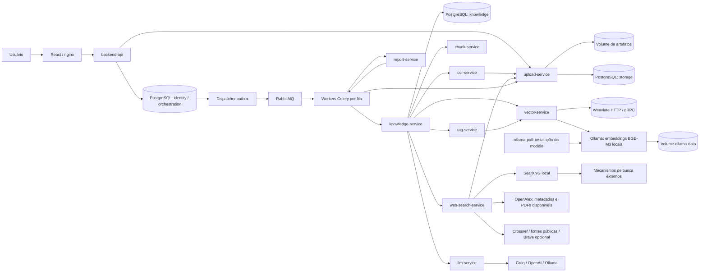
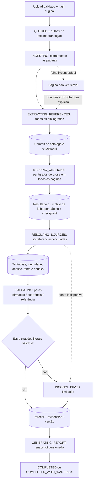

# Arquitetura

A imagem citada na solicitação não estava disponível no anexo. A tabela textual fornecida orientou a implementação. Cada API desenvolvida possui Dockerfile e imagem própria; processos API, workers e outbox do backend compartilham a imagem desse domínio.

| Bloco fornecido | Implementação | Fronteira |
|---|---|---|
| frontend node | frontend React/Vite/nginx | Somente chama a API pública; credenciais de provedores ficam no servidor |
| backend python | backend-api + workers + outbox | Autenticação, autorização por objeto, documentos, etapas e relatórios |
| upload_files | upload-service | Validação e armazenamento por identificadores; único volume de arquivos |
| OCR | ocr-service | Texto nativo primeiro, OCR seletivo, estrutura/geometria para seleção de prosa; extração original preservada |
| Chunks | chunk-service | Um parágrafo de prosa por trecho, sem sobreposição, com origem, páginas, offsets e hashes |
| VectorDB | vector-service + Weaviate oficial + Ollama | Embeddings BGE-M3 locais por padrão, índices separados por origem/modelo, busca híbrida |
| knowledge | knowledge-service | Proprietário dos registros bibliográficos, vínculos, fontes, evidências e histórico humano |
| RAG | rag-service | Busca limitada à obra/versão/usuário/documento; vizinhança e ampliação |
| LLM | llm-service | Saída estruturada sem ferramentas; validação semântica/proveniência |
| web_search | web-search-service + SearXNG local | Crossref + artigos OpenAlex + metabuscador open source, Brave opcional, identidade bibliográfica, acesso rastreável e downloads protegidos |
| gera pdf | report-service | Resumo determinístico do snapshot persistido, agrupamento de repetições e limite de 20 páginas |
| DataBase | PostgreSQL | Fonte de verdade; schemas e privilégios por domínio |

## Componentes

O conhecimento recebe os chunks persistidos, não caminhos de outro contêiner. Web search registra consultas, identidade e conteúdo; knowledge persiste as fontes antes de RAG/LLM. O manuscrito nunca entra como evidência de uma afirmação sua. O RAG amplia a leitura quando top-k não basta; cobertura incompleta impede uma condenação por ausência.

O texto original extraído alimenta o catálogo bibliográfico e conserva a proveniência. A seleção de prosa identifica blocos de parágrafos tanto na extração nativa quanto no OCR; tabelas, imagens, diagramas, legendas, títulos e rodapés detectados não entram no mapeamento semântico nem nos chunks. Fontes PDF e HTML seguem a mesma finalidade de seleção, usando a estrutura disponível em cada formato. Esse filtro é heurístico e não garante acerto em toda diagramação.

Cada chunk contém um parágrafo inteiro, sem janelas de caracteres nem sobreposição. A afirmação de uma ocorrência também usa o parágrafo que contém o marcador. Limites de entrada, contexto ou orçamento podem impedir o embedding ou a avaliação de um parágrafo longo; o sistema registra a limitação em vez de cortar o parágrafo silenciosamente. Uma nova análise aplica essas regras aos pareceres; reindexação e nova versão do relatório não reavaliam conclusões históricas.

O Compose inclui Ollama em CPU, sem porta publicada, e um processo de instalação que baixa `bge-m3:567m` antes de iniciar o serviço vetorial. Os vetores densos têm 1.024 dimensões; o índice combina sua busca com BM25 do Weaviate. Os textos de embeddings ficam na rede local; a avaliação das afirmações continua indo ao provedor LLM configurado.

Crossref verifica metadados bibliográficos e OpenAlex busca artigos por DOI ou título, priorizando PDFs públicos de acesso aberto depois de corroborar a identidade. Quando disponível, o PDF do acervo OpenAlex é uma alternativa autenticada com `OPENALEX_API_KEY`; essa chave fica restrita aos endpoints oficiais previstos pela integração. O conteúdo passa pelos filtros de identidade e prosa existentes antes de alimentar a recuperação. TEI XML não é processado. Falta de conteúdo ou falha do provedor permanece explícita e não comprova inexistência da obra.

SearXNG é o provedor padrão de descoberta web complementar, executado na rede interna do Compose com JSON habilitado. O serviço recebe metadados bibliográficos e consulta mecanismos externos pela internet. `SEARXNG_SECRET_KEY` protege operações criptográficas da instância e é gerado localmente, sem contratação de chave de busca. Snippets descobrem candidatos, mas a evidência depende do conteúdo obtido e da validação de identidade. Bloqueios ou indisponibilidade dos mecanismos limitam a cobertura; Brave permanece como adaptador opcional.

O relatório apresenta resumo, cobertura e detalhes priorizados, com teto de 20 páginas. Repetições são agrupadas; detalhes que não cabem são explicitamente sinalizados e continuam acessíveis na interface. O snapshot e os resultados completos permanecem persistidos. Relatórios anteriores não são reescritos: o novo formato se aplica à geração de uma nova versão.

## Fluxo e barreiras persistidas

Uma consulta HTTP longa não é executada como `BackgroundTasks` da API pública. A requisição de análise retorna 202 depois de persistir run, etapas e outbox. Mensagens carregam IDs, etapa e versão do evento. Celery não usa chords nem backend de resultados; a coordenação consulta o PostgreSQL. RabbitMQ é apenas broker.

Cada etapa tem chave única `(run_id, name)` e cada checkpoint de domínio `(run_id, stage)`. Advisory locks exclusivos por análise evitam execução concorrente; commits por fonte e parecer permitem retomada. A conclusão só agenda a próxima etapa depois do commit de domínio. O dispatcher usa publicação confirmada e reenvia eventos antigos não processados. Duplicatas são esperadas e deduplicadas; não há alegação de entrega exatamente uma vez.

Cancelamento é cooperativo entre etapas, fontes e pares. Uma operação HTTP/OCR já iniciada termina ou atinge timeout antes de observar o cancelamento. Falha de fonte é registrada como limitação, não aborta todas as fontes. Limites de tempo, consultas e tokens controlam trabalho externo; limites de conta do provedor continuam necessários.

## Decisões

- Um PostgreSQL local e três roles de aplicação reduzem a operação local mantendo proprietários de escrita definidos.
- Parser determinístico inicial, sem GROBID: evita um componente pesado sem treinamento/avaliação que justificasse seu uso. Limitações ficam explícitas; não há extração perfeita presumida.
- Migração SQL congelada e revisável; nenhum `create_all()` em startup.
- Documentos e fontes ficam em um volume administrado exclusivamente pelo upload-service. `Storage` define `put/get/delete` para substituir a implementação local por S3 no futuro; adaptador S3 não foi implementado.
- Groq é o provedor padrão de LLM (`qwen/qwen3.8-27b`); sem `GROQ_API_KEY`, o parecer fica inconclusivo com limitação explícita. Embeddings usam BGE-M3 via Ollama local, sem credencial paga. A demonstração utiliza anotações CC0 separadas dos provedores reais.
- Não há correção destrutiva de parecer. Novas análises reaplicam decisões humanas explícitas e preservam o histórico.
- Pesquisa multilíngue usa BGE-M3 por padrão, sem garantia de desempenho para um domínio específico. A versão `2` separa a nova configuração vetorial; documentos antigos precisam de reindexação. Sem embeddings, o fallback lexical é declarado e não equivale à busca semântica entre idiomas.
