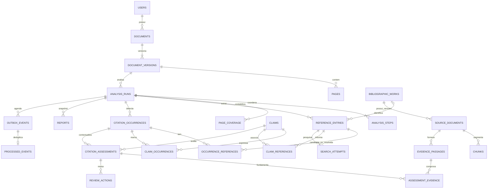

# Dados, cardinalidade e integridade

O SQL inicial em `migrations/versions/0001_initial.sql` é o artefato executado pelo Alembic. Contém 26 tabelas, tipo enumerado de estado da análise, chaves, checks e índices explícitos. `packages/common/models.py` mantém o ORM; schemas HTTP/LLM estão em `packages/contracts/`, sem herdar os models.

| Schema / escritor | Tabelas | Leitura |
|---|---|---|
| identity / backend (`api_writer`) | users | backend, knowledge |
| orchestration / backend e seus workers (`api_writer`) | documents, document_versions, analysis_runs, analysis_steps, outbox_events, processed_events, reports | backend, knowledge |
| knowledge / knowledge-service (`knowledge_writer`) | pages, page_coverage, checkpoints, chunks, reference_entries, bibliographic_works, citation_occurrences, claims, occurrence_references, claim_occurrences, claim_references, source_documents, search_attempts, evidence_passages, citation_assessments, assessment_evidence, review_actions | backend, knowledge |
| storage / upload-service (`upload_writer`) | files | upload-service |

Serviços sem estado não usam credenciais de escrita de outros domínios. O backend lê conhecimento para consultar resultados; toda mutação de evidências e revisões passa pela API proprietária. O migrator é o único processo com privilégios administrativos e executa uma vez antes da aplicação.

Entradas duplicadas da bibliografia não são eliminadas. O DOI não é único em `reference_entries`. A identidade canônica possui índice único parcial `(document_id, normalized_doi)` quando DOI não é nulo; manter o escopo do documento evita compartilhamento acidental de conteúdo entre usuários. Arquivos/edições permanecem separados em `source_documents`.

Páginas possuem índice físico zero-based e número físico one-based, com check `physical_page_number = physical_index + 1`. O rótulo impresso é independente. Há unicidade por `(document_version_id, physical_page_number)`, enquanto `page_coverage` preserva a cobertura de cada análise. Qualidade é JSONB com contagens, OCR e descrição da ordem de leitura.

Offsets são locais ao texto normalizado, não bytes nem coordenadas da página. Blocos preservam caixas em pontos PDF; localizações entre páginas têm endpoints separados no JSONB. Os campos escalares mantêm intervalos válidos; o frontend informa quando a posição é aproximada.

FKs compostas asseguram:

- run com dono e documento compatíveis;
- versão pertencente ao documento;
- occurrence/reference/claim/assessment/evidence no mesmo run;
- passagem pertencente à mesma fonte, obra e versão;
- chunks com dono e documento compatíveis.

Regras adicionais entre tabelas são verificadas transacionalmente pelo knowledge-service: referência/obra do documento correto, seleção humana dentro do run, fonte anexada do dono correto, passagem idêntica ao chunk SQL e quote realmente contida na passagem. Essas verificações não são expressas como `CHECK` entre tabelas. `current_version_id` é mantido na transação de upload, sem FK circular.

UUIDs determinísticos em chunks/artefatos/checkpoints evitam duplicação na retomada. Tabelas associativas têm chave composta única. Checks impedem páginas negativas, intervalos/offsets inválidos, contagens negativas e chunks de fonte sem obra/origem. Não há confiança numérica apresentada como probabilidade.

Exclusão de documento é uma operação assíncrona: marca como indisponível, remove vetores por dono/documento, remove os arquivos por API e por fim apaga o documento com cascatas relacionais. Não é permitida durante análise ativa. Falha mantém o estado de exclusão para retentativa; nunca declara sucesso antes de apagar os artefatos. Backups têm retenção administrativa separada.
